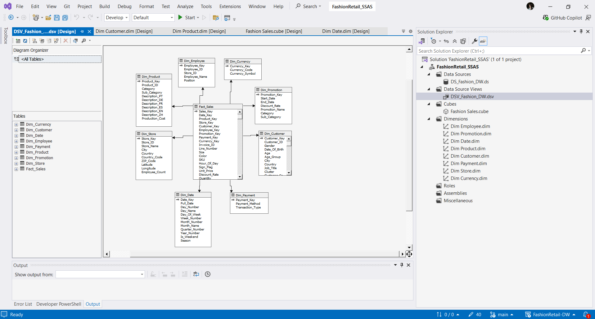
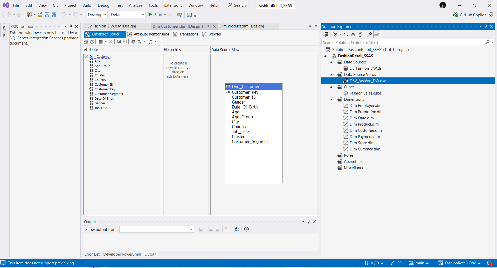
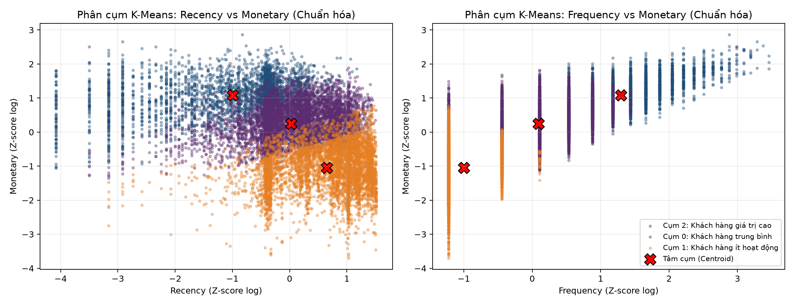
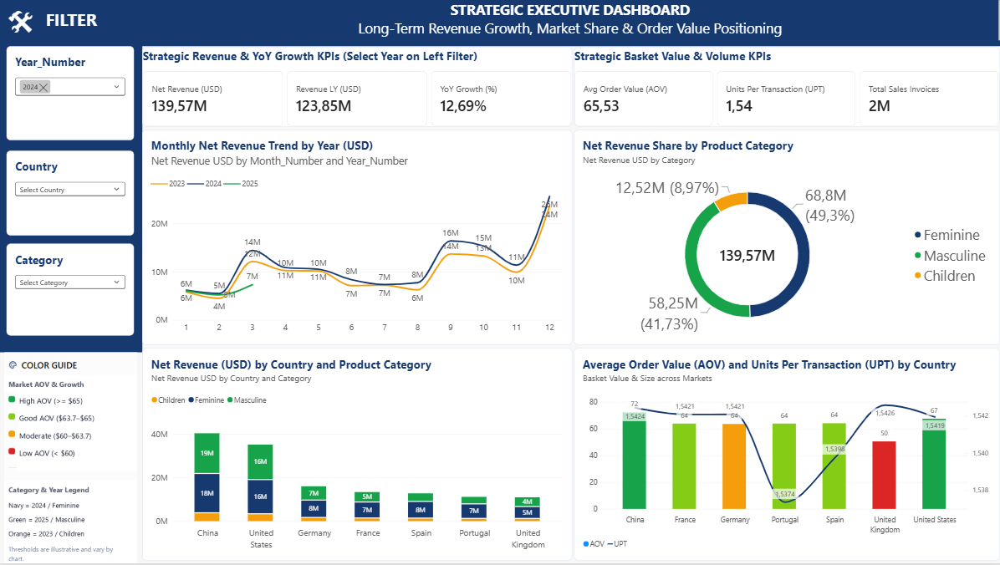
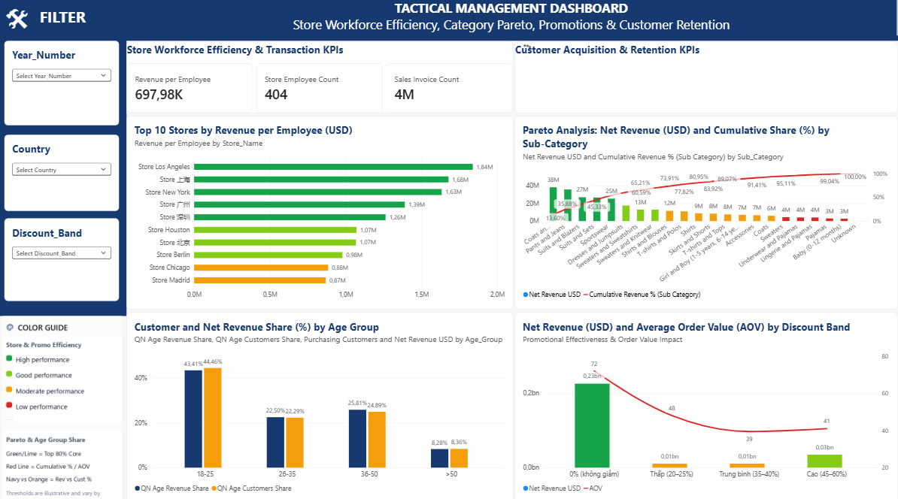
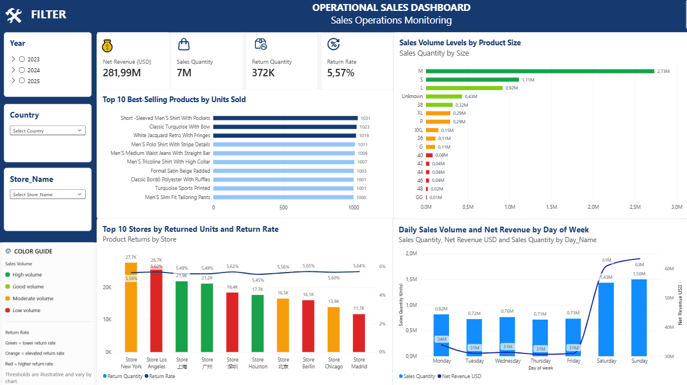
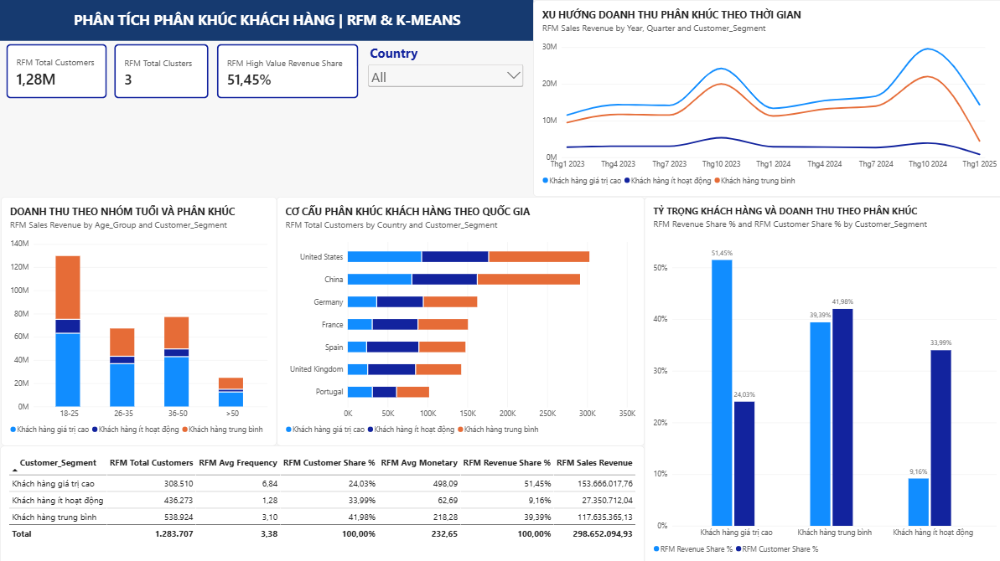

# FashionRetail-DW

Hệ thống Kho dữ liệu (Data Warehouse), Phân tích đa chiều (OLAP) và Hỗ trợ ra quyết định (DSS) cho chuỗi cửa hàng bán lẻ thời trang đa quốc gia.

## 1. Tổng quan bài toán

Dự án xây dựng quy trình xử lý và khai thác dữ liệu bán lẻ theo phương pháp luận mô hình chiều Kimball (Bottom-Up), chuyển đổi dữ liệu giao dịch rời rạc từ nhiều nguồn thành kho dữ liệu chuẩn hóa phục vụ phân tích đa chiều, mô phỏng chính sách chiết khấu và phân khúc khách hàng.

| Hạng mục | Thông tin chi tiết |
| :--- | :--- |
| Nguồn dữ liệu | Global Fashion Retail Stores Dataset (Kaggle) và tỷ giá lịch sử ECB (Frankfurter API) |
| Phạm vi thời gian | 01/01/2023 đến 18/03/2025 |
| Quy mô dữ liệu gốc | 6.416.827 dòng giao dịch, 1.643.306 khách hàng, 17.940 sản phẩm, 35 cửa hàng, 404 nhân viên |
| Phạm vi địa lý và tiền tệ | 7 quốc gia (Hoa Kỳ, Trung Quốc, Đức, Pháp, Tây Ban Nha, Anh, Bồ Đào Nha); 4 đơn vị tiền tệ (USD, EUR, GBP, CNY) |
| Công nghệ sử dụng | Python (Pandas, Scikit-learn), Microsoft SQL Server, SSIS, SSAS (MDX), Power BI (DAX) |

## 2. Kiến trúc hệ thống

Hệ thống được tổ chức thành 5 tầng xử lý độc lập, đảm bảo tách biệt giữa dữ liệu thô, vùng đệm trung gian, kho dữ liệu phân tích và tầng trình bày báo cáo.

| Tầng xử lý | Công cụ | Đầu vào / Đầu ra | Nhiệm vụ chính |
| :--- | :--- | :--- | :--- |
| 1. Khảo sát và Tiền xử lý | Python, Pandas | 6 tệp CSV gốc -> `data/cleaned/` | Khảo sát chất lượng dữ liệu, xử lý giá trị thiếu và trùng lặp, kiểm soát 13 quy tắc nghiệp vụ, quy đổi 4 ngoại tệ về USD theo tỷ giá ngày. |
| 2. Vùng đệm (Staging) | SQL Server, SSIS | `data/cleaned/` -> `Fashion_Staging` | Tiếp nhận dữ liệu đã làm sạch bằng cơ chế Fast Load, chuẩn hóa mã hóa Unicode (`DT_WSTR`) và đối soát số lượng bản ghi. |
| 3. Kho dữ liệu (Data Warehouse) | SQL Server, SSIS | `Fashion_Staging` -> `Fashion_DW` | Xây dựng mô hình Star Schema (1 bảng Fact, 8 bảng Dimension), kiểm lọc qua Conditional Split và ánh xạ khóa thay thế qua chuỗi 8 Lookup. |
| 4. Phân tích OLAP và Phân cụm ML | SSAS (MDX), Scikit-learn | `Fashion_DW` -> Cube `Fashion Sales` và nhãn RFM | Xây dựng khối đa chiều OLAP với 3 cấu trúc phân cấp; huấn luyện mô hình RFM kết hợp MiniBatchKMeans và nạp ngược nhãn phân khúc vào `Dim_Customer`. |
| 5. Trực quan hóa và DSS | Power BI, DAX | `Fashion_DW` -> `FashionRetail_DSS_RFM.pbit` | Xây dựng hệ thống Dashboard theo 3 cấp quản trị (Chiến lược, Chiến thuật, Tác nghiệp), trang mô phỏng What-If và trang phân tích phân khúc RFM. |

## 3. Thiết kế Kho dữ liệu và Kiểm soát chất lượng

### 3.1. Xử lý dữ liệu và cổng kiểm soát chất lượng (Python)

* **Xử lý trùng lặp:** Loại bỏ 798 bản ghi trùng lặp hoàn toàn trên 19 cột (toàn bộ là giao dịch Return), giảm từ 6.416.827 xuống 6.416.029 dòng. Đối với 41.158 dòng trùng khóa nghiệp vụ `(Invoice_ID, Line)` nhưng khác nội dung sản phẩm, hệ thống giữ lại và gắn nhãn `REVIEW` thay vì tự động xóa nhằm tránh thất thoát giao dịch thực tế.
* **Xử lý dữ liệu thiếu:** Gán nhãn tường minh `'Unknown'` cho các thuộc tính khuyết mang đặc thù nghiệp vụ như `Color` (67,80% ở bảng giao dịch), `Size` (6,44%) và `Job Title` (35,55%) để bảo toàn dữ liệu.
* **Quy tắc nghiệp vụ (R1–R13):** Kiểm tra toàn bộ 13 điều kiện về số lượng, đơn giá, tỷ lệ chiết khấu, khóa tham chiếu, dấu thành tiền theo loại giao dịch và tính hợp lệ của chương trình khuyến mãi. Toàn bộ bản ghi hợp lệ đạt 100% các điều kiện R1–R12.
* **Quy đổi đa tiền tệ:** Tích hợp bảng tỷ giá lịch sử từ ECB (`data/reference/exchange_rates.csv`) để quy đổi doanh thu từ EUR, GBP, CNY về USD, lưu kèm tỷ giá và ngày áp dụng để phục vụ đối soát.

### 3.2. Mô hình Star Schema và Kiểm thử sau ETL (`Fashion_DW`)

* **Grain:** Mỗi bản ghi trong `dbo.Fact_Sales` tương ứng với một dòng chi tiết sản phẩm trong hóa đơn bán (`Sale`) hoặc trả hàng (`Return`).
* **Cấu trúc bảng:** Gồm bảng sự kiện trung tâm `dbo.Fact_Sales` (6.415.456 bản ghi hợp lệ; 573 bản ghi trùng được tách riêng vào `stg.transactions_duplicate_backup` tại tầng Staging) liên kết với 8 bảng chiều: `Dim_Date`, `Dim_Product`, `Dim_Store`, `Dim_Customer`, `Dim_Employee`, `Dim_Promotion`, `Dim_Payment` và `Dim_Currency`.
* **Kết quả kiểm thử toàn vẹn (SQL):** 0 khóa chính NULL hoặc trùng lặp tại `Fact_Sales`; 0 bản ghi mồ côi (Orphan Rows) trên cả 8 khóa ngoại; 0 dòng vi phạm miền giá trị nghiệp vụ.

## 4. Phân tích đa chiều OLAP (SSAS và MDX)

Từ cơ sở dữ liệu `Fashion_DW`, khối đa chiều **Fashion Sales** được triển khai trên SQL Server Analysis Services:

* **Phân cấp chiều (Hierarchies):** Xây dựng 3 cấu trúc phân cấp phục vụ thao tác Drill-down và Roll-up gồm `Calendar` (Year - Quarter - Month - Date), `Store Geography` (Country - City - Store Name) và `Product Hierarchy` (Category - Sub Category - Product ID).
* **Calculated Measures:** Định nghĩa `AOV` (Giá trị đơn hàng trung bình) và `UPT` (Số sản phẩm trung bình trên hóa đơn) có xử lý điều kiện tránh lỗi chia cho 0.
* **Truy vấn MDX:** Triển khai 6 kịch bản truy vấn OLAP trong thư mục `SSAS/MDX_Queries/` bao gồm: doanh thu theo năm, ma trận AOV và UPT theo quốc gia và phương thức thanh toán, Top 10 cửa hàng và nhân viên, Top 10 sản phẩm bán chạy, lượng hàng trả lại theo danh mục và hiệu quả theo chương trình khuyến mãi.

## 5. Phân khúc khách hàng bằng RFM và MiniBatchKMeans

Mô hình phân cụm không giám sát được thực hiện trên **1.283.707 khách hàng** có phát sinh giao dịch mua hàng (`Sign_Flag = 1`), chốt dữ liệu tại ngày `18/03/2025`:

* **Tiền xử lý:** Áp dụng biến đổi `log1p` nhằm giảm ảnh hưởng của phân phối lệch phải (Recency tối đa 807 ngày, Monetary tối đa 3.274,50 USD), sau đó chuẩn hóa bằng `StandardScaler`.
* **Lựa chọn mô hình:** Sử dụng `MiniBatchKMeans` để tối ưu hiệu năng trên hơn 1,28 triệu quan sát. Khảo sát số cụm $K$ từ 3 đến 6 trên tập mẫu 100.000 khách hàng; chọn $K = 3$ do đạt chỉ số **Silhouette Score cao nhất (0,3805)**.
* **Tích hợp vào hệ thống BI:** Kết quả phân cụm (`Cluster`, `Customer_Segment`) được nạp trực tiếp vào bảng `dbo.Dim_Customer`, xử lý lại (Reprocess) khối `Fashion Sales` trên SSAS và đồng bộ lên Power BI để phân tích chéo theo thời gian, nhóm tuổi và quốc gia.

| Phân khúc | Số khách hàng | Tỷ trọng khách | Recency trung bình (trung vị) | Frequency trung bình | Monetary trung bình | Tỷ trọng doanh thu bán |
| :--- | :---: | :---: | :---: | :---: | :---: | :---: |
| Cụm 2 – Khách hàng giá trị cao | 308.510 | 24,03% | 65,28 ngày (70) | 6,84 đơn | 498,09 USD | 51,45% |
| Cụm 0 – Khách hàng trung bình | 538.924 | 41,98% | 186,47 ngày (142) | 3,10 đơn | 218,28 USD | 39,39% |
| Cụm 1 – Khách hàng ít hoạt động | 436.273 | 33,99% | 364,30 ngày (365) | 1,28 đơn | 62,69 USD | 9,16% |

## 6. Kết quả phân tích và Hệ thống Dashboard Power BI

### 6.1. Các phát hiện nghiệp vụ chính

* **Tăng trưởng và thị trường trọng điểm:** Tổng doanh thu thuần lũy kế đạt 281,99 triệu USD; năm 2024 đạt 139,57 triệu USD, tăng 12,69% so với năm 2023 (123,85 triệu USD). Hai thị trường Trung Quốc (26,67%) và Hoa Kỳ (26,61%) đóng góp 53,28% tổng doanh thu toàn chuỗi.
* **Cấu trúc giỏ hàng (AOV và UPT):** Số sản phẩm trung bình trên hóa đơn (UPT) đồng đều ở mức 1,54 sản phẩm tại mọi quốc gia và hình thức thanh toán, nhưng giá trị đơn hàng trung bình (AOV) phân hóa mạnh từ 71,63 USD (Trung Quốc) xuống 51,87 USD (Anh), cho thấy sự khác biệt nằm ở phân khúc giá sản phẩm tiêu thụ.
* **Hiệu suất cửa hàng:** Store New York dẫn đầu về tổng doanh thu (21,23 triệu USD), nhưng xét theo năng suất nhân sự, Store Los Angeles đứng đầu hệ thống với 1,84 triệu USD/nhân viên (so với 1,63 triệu USD/nhân viên tại New York).
* **Danh mục sản phẩm và trả hàng:** Cần 38,66% mã sản phẩm (6.935 mã) để tạo ra 80% doanh thu; 3 kích cỡ M (40,85%), S (16,64%) và L (13,71%) chiếm 71,20% sản lượng bán. Tỷ lệ trả hàng toàn chuỗi đạt 5,57% và đồng đều giữa các danh mục.
* **Khách hàng quay lại và chiết khấu:** Nhóm khách quay lại chiếm 73,86% lượng khách nhưng đóng góp 92,36% doanh thu. Doanh số nguyên giá (giảm 0%) chiếm 81,1% tổng doanh thu bán (298,65 triệu USD). Mô phỏng What-If trên Power BI cho thấy chính sách giảm giá 20% toàn chuỗi sẽ làm hụt 59,73 triệu USD nếu sản lượng không tăng tối thiểu 25,0% để đạt điểm hòa vốn.

### 6.2. Giao diện hệ thống Dashboard

**Dashboard Cấp Chiến lược (Strategic):** Theo dõi doanh thu thuần, tăng trưởng YoY, cơ cấu theo danh mục, thị trường và chỉ số AOV/UPT.

**Dashboard Cấp Chiến thuật (Tactical):** Đánh giá năng suất nhân viên theo cửa hàng, phân tích Pareto danh mục, cơ cấu nhóm tuổi và hiệu quả theo dải giảm giá.

**Dashboard Cấp Tác nghiệp (Operational):** Giám sát sản lượng bán, Top 10 sản phẩm bán chạy, phân bố kích cỡ, tình hình trả hàng theo cửa hàng và chu kỳ bán hàng theo ngày trong tuần.

**Dashboard Phân tích phân khúc khách hàng (RFM và K-Means):** Theo dõi biến động doanh thu 3 phân khúc theo thời gian, nhóm tuổi và thị trường quốc gia.

## 7. Cấu trúc thư mục dự án

| Đường dẫn | Nội dung |
| :--- | :--- |
| `Python/2.2_Khao_sat_du_lieu/` | Script khảo sát dữ liệu thiếu, trùng lặp, kiểm tra 13 quy tắc nghiệp vụ và phân tích bất thường. |
| `Python/2.3_Tien_xu_ly_du_lieu/` | Script làm sạch, chuẩn hóa kiểu dữ liệu, tạo thuộc tính dẫn xuất, quy đổi tỷ giá USD và xuất dữ liệu sạch. |
| `data/reference/` | Bảng ánh xạ tên quốc gia (`country_mapping.csv`) và tỷ giá lịch sử ECB (`exchange_rates.csv`). Dữ liệu lớn không lưu trên Git. |
| `SQL/` | Chuỗi script khởi tạo Staging, Star Schema (`Fashion_DW`), nạp dữ liệu, đối soát toàn vẹn và cập nhật nhãn RFM. |
| `SSIS/FashionRetail_ETL/` | Solution SSIS, kết nối nguồn/đích và các gói Data Flow nạp Staging, 8 Dimension, Fact và Customer Segments. |
| `SSAS/FashionRetail_SSAS/` | Dự án SSAS Multidimensional gồm Data Source, Data Source View, 8 Dimension và Cube `Fashion Sales`. |
| `SSAS/MDX_Queries/` | 6 tệp truy vấn OLAP bằng ngôn ngữ MDX tương ứng với các bài toán phân tích nghiệp vụ. |
| `RFM_KMeans/` | Notebook `RFM_KMeans.ipynb`, các script trích xuất/huấn luyện/kiểm tra và biểu đồ đánh giá phân cụm. |
| `PowerBI/` | Tệp mẫu `FashionRetail_DSS_RFM.pbit` chứa mô hình Star Schema, công thức DAX và giao diện các trang Dashboard. |
| `Docs/` | Hình ảnh sơ đồ kiến trúc (`architecture/`) và ảnh chụp giao diện báo cáo (`dashboards/`). |

## 8. Hạn chế của dữ liệu và phạm vi phân tích

* **Dữ liệu năm 2025 chưa trọn năm:** Giao dịch mới ghi nhận đến ngày 18/03/2025, do đó mọi so sánh tăng trưởng cùng kỳ (YoY) của năm 2025 đều giới hạn trên khoảng thời gian tương đương của năm 2024 (01/01 – 18/03).
* **Phạm vi chỉ tiêu tài chính:** Tập dữ liệu nguồn chưa có tồn kho, chi phí vận hành, đơn vị tiền tệ gốc của giá vốn (`Production Cost`) và lý do trả hàng. Hệ thống tập trung đánh giá doanh thu thuần và doanh thu bán thay vì lợi nhuận ròng.
* **Khuyến mãi và mô hình RFM:** Dữ liệu giao dịch không có mã chương trình khuyến mãi để nối trực tiếp với `Dim_Promotion`, nên phân tích chiết khấu dựa trên tỷ lệ giảm giá ghi nhận ở từng dòng. Chỉ số Monetary trong mô hình RFM tính trên giao dịch bán (`Sign_Flag = 1`), tách biệt với doanh thu thuần đã trừ hàng trả lại.